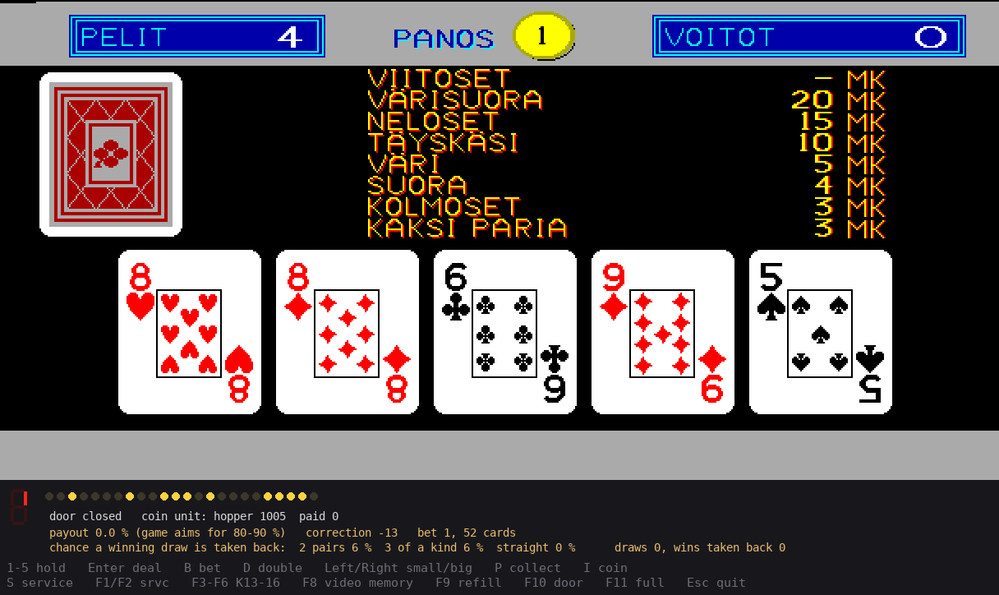

# RAY POKERI emulator

An emulator of the Finnish RAY (Raha-automaattiyhdistys) "POKERI" video
poker machine from 1990, in Python. The 68000 CPU runs on the Musashi core
(machine68k); the graphics chip (HD63484 ACRTC), sound chip, I/O chips and
coin processor are emulated in Python.

The ROMs are not included. See [README.txt](../README.txt) for the ROM
files, how to start it and the keys, [GAME.txt](../GAME.txt) for the game
and [HARDWARE.txt](../HARDWARE.txt) for the board.

The emulator's own files are released under [CC0 1.0](../LICENSE). This
doesn't cover the game: the ROMs, and the game's pictures, texts and
sounds, belong to RAY (now Veikkaus).
